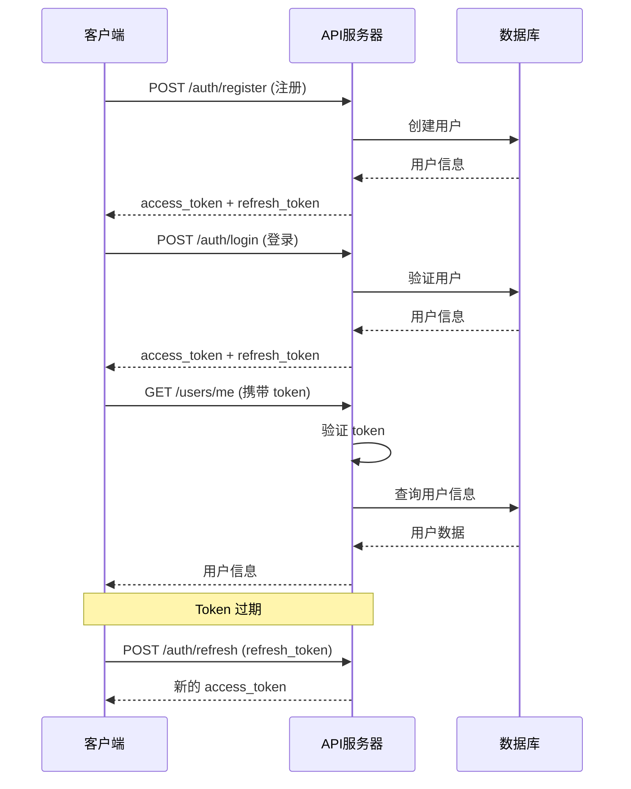
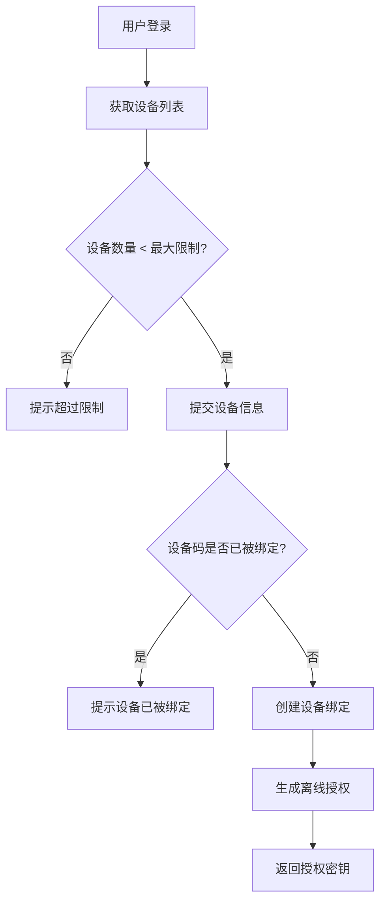
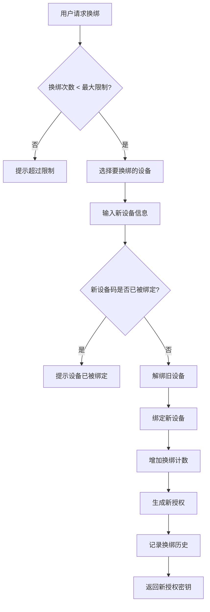
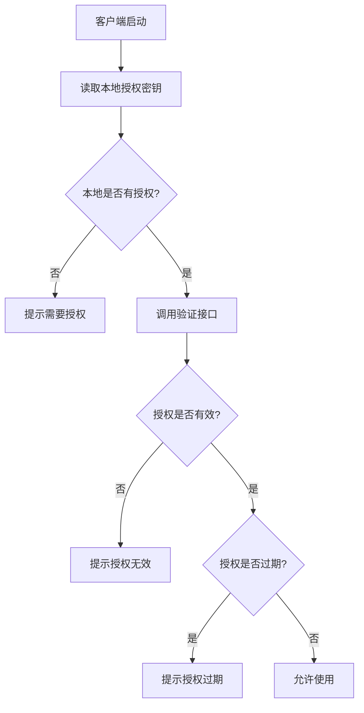

# LovelyRes API 快速参考

## 基础信息

- **Base URL**: `https://api.lovelyres.com/v1`
- **认证方式**: JWT Bearer Token
- **Content-Type**: `application/json`

---

## 认证流程



---

## API 速查表

### 🔐 认证相关

| 方法 | 路径 | 说明 | 认证 |
|------|------|------|------|
| POST | `/auth/register` | 用户注册 | ❌ |
| POST | `/auth/login` | 用户登录 | ❌ |
| POST | `/auth/refresh` | 刷新 Token | ❌ |
| POST | `/auth/logout` | 用户登出 | ✅ |

### 👤 用户信息

| 方法 | 路径 | 说明 | 认证 |
|------|------|------|------|
| GET | `/users/me` | 获取当前用户信息 | ✅ |
| PATCH | `/users/me` | 更新用户信息 | ✅ |
| POST | `/users/me/password` | 修改密码 | ✅ |

### 💻 设备管理

| 方法 | 路径 | 说明 | 认证 |
|------|------|------|------|
| GET | `/devices` | 获取设备列表 | ✅ |
| POST | `/devices` | 绑定设备 | ✅ |
| GET | `/devices/{id}` | 获取设备详情 | ✅ |
| DELETE | `/devices/{id}` | 解绑设备 | ✅ |
| POST | `/devices/rebind` | 换绑设备 | ✅ |

### 🔑 离线授权

| 方法 | 路径 | 说明 | 认证 |
|------|------|------|------|
| POST | `/licenses/generate` | 生成离线授权 | ✅ |
| POST | `/licenses/update` | 更新离线授权 | ✅ |
| POST | `/licenses/verify` | 验证离线授权 | ❌ |
| GET | `/licenses/history` | 获取授权历史 | ✅ |

### 📜 历史记录

| 方法 | 路径 | 说明 | 认证 |
|------|------|------|------|
| GET | `/history/device-bindings` | 获取设备换绑历史 | ✅ |

---

## 常用请求示例

### 注册用户

```bash
curl -X POST https://api.lovelyres.com/v1/auth/register \
  -H "Content-Type: application/json" \
  -d '{
    "username": "testuser",
    "nickname": "测试用户",
    "email": "test@example.com",
    "password": "password123"
  }'
```

### 用户登录

```bash
curl -X POST https://api.lovelyres.com/v1/auth/login \
  -H "Content-Type: application/json" \
  -d '{
    "username": "testuser",
    "password": "password123"
  }'
```

### 获取用户信息

```bash
curl -X GET https://api.lovelyres.com/v1/users/me \
  -H "Authorization: Bearer YOUR_ACCESS_TOKEN"
```

### 绑定设备

```bash
curl -X POST https://api.lovelyres.com/v1/devices \
  -H "Authorization: Bearer YOUR_ACCESS_TOKEN" \
  -H "Content-Type: application/json" \
  -d '{
    "device_code": "ABC123XYZ",
    "device_name": "我的电脑",
    "device_type": "windows"
  }'
```

### 生成离线授权

```bash
curl -X POST https://api.lovelyres.com/v1/licenses/generate \
  -H "Authorization: Bearer YOUR_ACCESS_TOKEN" \
  -H "Content-Type: application/json" \
  -d '{
    "device_id": 1,
    "valid_days": 365
  }'
```

### 验证离线授权

```bash
curl -X POST https://api.lovelyres.com/v1/licenses/verify \
  -H "Content-Type: application/json" \
  -d '{
    "license_key": "LOVELYRES-XXXX-XXXX-XXXX-XXXX",
    "device_code": "ABC123XYZ"
  }'
```

---

## 响应格式

### 成功响应

```json
{
  "code": 200,
  "message": "success",
  "data": { ... },
  "timestamp": 1704902400000
}
```

### 错误响应

```json
{
  "code": 400,
  "message": "用户名已存在",
  "error": "USERNAME_EXISTS",
  "timestamp": 1704902400000
}
```

---

## 常见错误码

| HTTP 状态码 | 错误码 | 说明 |
|------------|--------|------|
| 400 | `USERNAME_EXISTS` | 用户名已存在 |
| 400 | `EMAIL_EXISTS` | 邮箱已存在 |
| 401 | `INVALID_CREDENTIALS` | 用户名或密码错误 |
| 401 | `TOKEN_EXPIRED` | Token 已过期 |
| 401 | `TOKEN_INVALID` | Token 无效 |
| 403 | `DEVICE_LIMIT_EXCEEDED` | 设备数量超过限制 |
| 403 | `REBIND_LIMIT_EXCEEDED` | 换绑次数超过限制 |
| 403 | `VIP_REQUIRED` | 需要 VIP 权限 |
| 403 | `VIP_EXPIRED` | VIP 已过期 |
| 404 | `DEVICE_NOT_FOUND` | 设备不存在 |
| 409 | `DEVICE_ALREADY_BOUND` | 设备已被绑定 |

---

## 业务流程

### 设备绑定流程



### 设备换绑流程



### 离线授权验证流程



---

## 速率限制

| 接口类型 | 限制 | 说明 |
|---------|------|------|
| 登录/注册 | 5次/分钟 | 防止暴力破解 |
| 一般接口 | 60次/分钟 | 正常使用限制 |
| 授权验证 | 100次/分钟 | 高频验证场景 |

---

## 开发工具

### Postman Collection

导入以下 URL 到 Postman：
```
https://api.lovelyres.com/postman/collection.json
```

### OpenAPI/Swagger

在线文档地址：
```
https://api.lovelyres.com/docs
```

---

## 相关文档

- [完整 API 文档](./api-documentation.md)
- [数据库设计文档](./database-design.md)
- [数据库安装指南](./database-setup-guide.md)

---

**版本**: 1.0.0  
**更新**: 2025-01-10

